# PA2 Report: Parallelizing Polynomial Multiplication

Name: Alexander Stanton
Date: 9/28/2026

<!--
Claude's overall note on this draft: this is a direct translation of notes.md
into report form, in the same order the experiments happened. I've kept your
own conclusions and wording as the substance of each section rather than
rewriting your interpretations. Section-specific commentary is inlined as
HTML comments near the relevant material; a few cross-cutting notes:

- Almost every section below other than GSP1 has no embedded figure. You have
  the actual .xlsx workbooks under each variant's plots/ directory (and the
  cross-cutting perf tables) - worth pulling screenshots the same way you
  did for GSP1's image.png/image-1.png before this is submission-ready.
- notes.md has several sentences that stop mid-thought (OPP12's "`perf`
  shows us that", OPP2's "Outer parallelism would be difficult to obtain
  because", OPP21's "which is", and the file's own last line). I've left
  those out of the report body rather than guess an ending, and flagged each
  spot below.
- The report currently has no overall Discussion/Conclusion tying OPQ, EXQ,
  and (eventually) BKQ together. That synthesis is yours to write once BKQ
  exists - I haven't attempted it.
-->

## 01 GSP1

### Initial Test

When I first started parallelizing OPQ, I misrepresented my intentions to Claude, resulting in an implementation of parallel GSQ which we called OPP1 at first.

#### Introduction

Parallelizing the GSQ implementation will allow us to test how well it scales.

#### Design

Parallelized GSQ with round-robin scheduling on the outer loop, such that the outer loop determines the written-to index and the inner loop derives the read-from indices.

Sweep was run with dA=dB=2000 averaged across 5 runs, expectation for near-perfect speedup.

#### Results

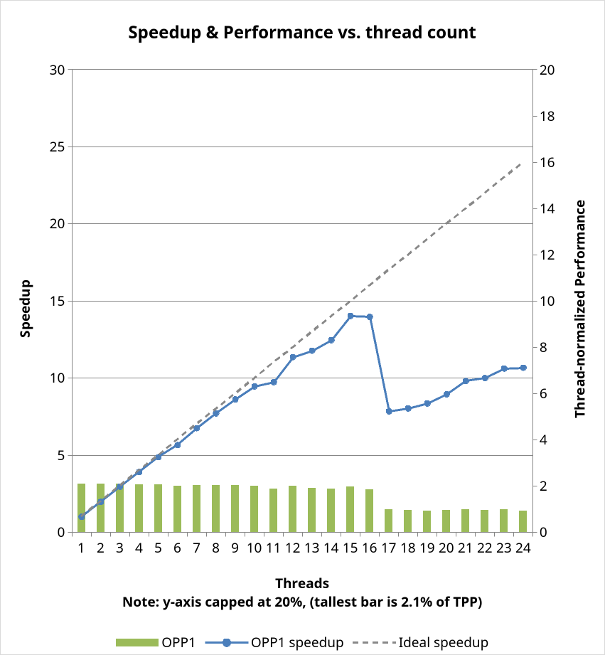

Here we see that speedup is near-perfect up to 16 threads, then dropped off to an abrupt negative speedup delta, then gradual increases again. This subsequent increase is itself roughly linear.

#### Conclusion

This drop could be due to context switching between threads once we saturate the 16 physical E-cores with threads.

### Overriding the Core Limits

#### Introduction

Overriding the default cores should allow for a perfect speedup all the way through 32 threads.

#### Design

Claude overrode the default core limits, using 1 thread per P-core and then one thread per E-core (`BPM_CORESET=0-31`, with a matching `BPM_OMP_PLACES` cycling P-cores before E-cores).

#### Results

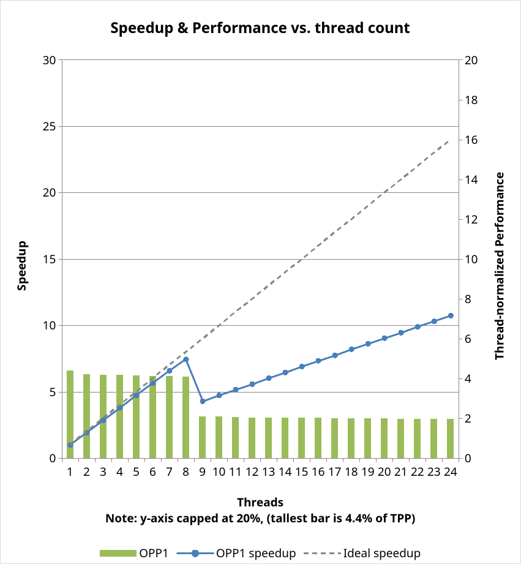

Two regimes of near-perfect linear trends appear. When we use our 8 P-cores fist, we get a speedup trend approximately double what we get with the remaining 16 E-cores.

When pinning just to our E-cores, we see an almost-perfect speedup across all 16 threads.

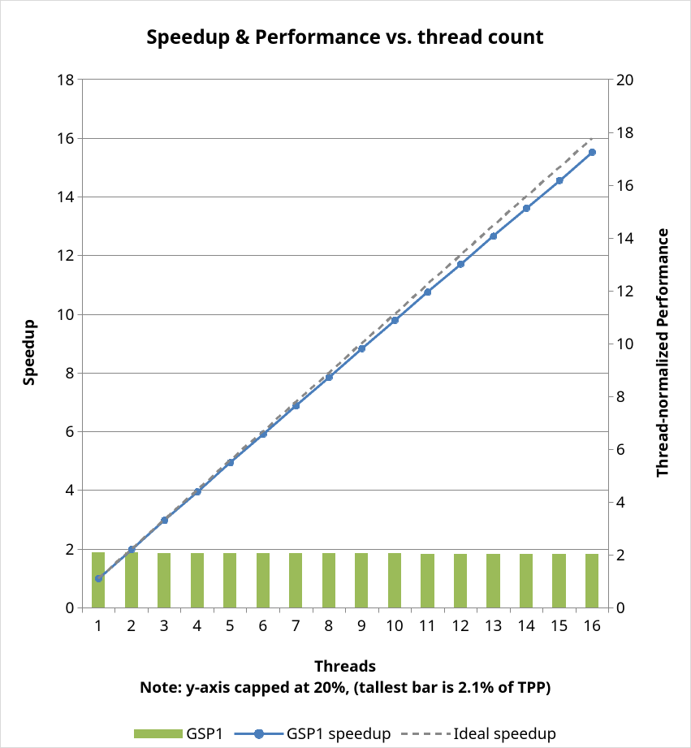

#### Conclusion

Because our baseline is using a P-core, this makes sense, and indicates that we are getting virtually perfect speedup for P-cores, then virtually perfect speedup for additional E-cores, but seeing a comparatively worse result for the E-cores because the baseline is higher.

We will use only E-cores, and ranges of 1-16 threads, going forward.

## 01 OPQ

Claude wrote an implementation of OPQ (VARIANTS.md's outer-product loop reorganization) and it passed the correctness gate. OPQ itself carries no explicit parallelism or tuning parameters - it is the sequential loop-order baseline that every `OPP*` variant below builds on.

## 01 OPQ Parallel Exploration (OPP1-OPP19, OPP110)

### OPP1

#### Introduction

Our attempt to parallelize the outer loop last time resulted in a GSP algorithm, so here we will attempt to parallelize the inner loop with round-robin scheduling instead.

This should afford some speedup, but it will likely be far from perfect because the thread pool is created and destroyed every time the outer loop iterates.

#### Hypothesis

Parallelizing the inner loop is likely to result in less-than optimal speedup, and is likely to suffer from per-thread overhead due to repeated fork/joins. I expect to see a small speedup which tapers off as thread count increases.

#### Design

Added a `schedule(static, 1)` clause to the internal loop, using a fused `#pragma omp parallel for` inside the outer loop.

#### Results

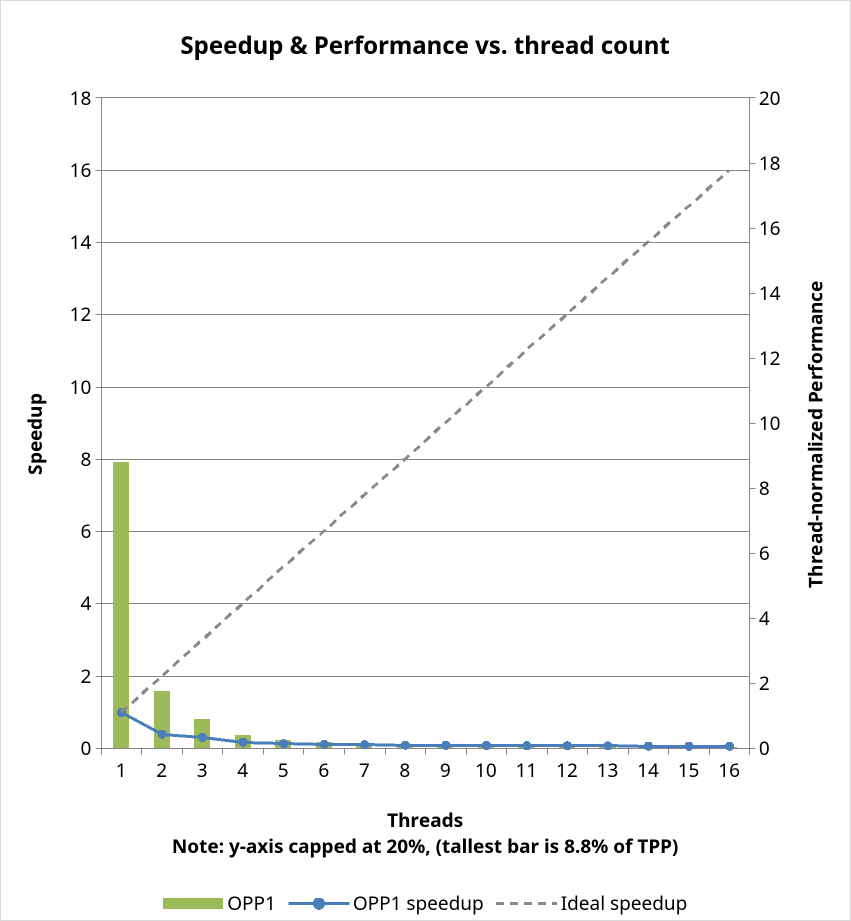

Surprisinglu, we see that speedup is negative as thread count increases. Adding more threads results in a slower program overall.

#### Conclusion

Because adding threads results in such an incredible underperformance, it is clear that synchronization overhead may be dominating in a more significant way than expected.

### OPP11

#### Introduction

Is there a way to reuse threads between outer-loop iterations, so we don't pay the cost of recreating the thread pool?

Placing a parallel pragma outside the loop could allow us to avoid the cost of a fork-join on every outer iteration.

Parallelizing the inner loop with a parallel for, while keeping the parallel pragma around the outer loop, should leave us with a slowdown that is proportional to the synchronization overhead of the inner loop, which will be less than a full inner parallelization.

#### Hypothesis

There's no content to the outer loop other than the inner loop, so splitting the `parallel` from the `for` may allow us to keep threads alive between iterations. I believe that this will allow us to see a positive relationship between thread count and speedup.

#### Design

Split the `parallel` clause from the `for` clause, keeping the `for` in the inner loop and moving the `parallel` to the outer loop.

#### Results

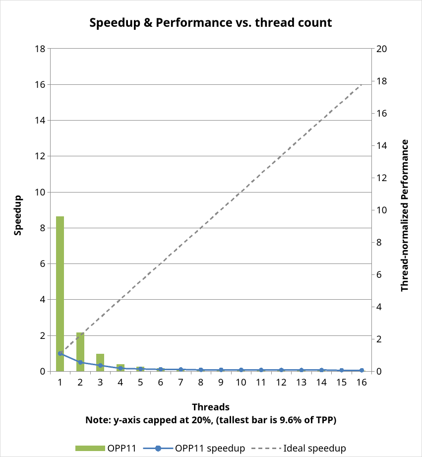

There is a very marginal increase in speedup, but not substantial enough to warrant further development. Looking at total runtime vs. thread count gives a roughly linear relationship, indicating that each additional thread is incurring a constant overhead instead of spreading the total work.

#### Conclusion

The curve moves from worse than 1/p to approximately 1/p, indicating that some improvement was made, but that the program is effectively running on a single thread. The cost of creating threads is not dominating for this parallelization.

### OPP12

#### Introduction

If multiple threads have sequential `j` values, they will be writing within the same cache line, causing false sharing. `getconf LEVEL1_DCACHE_LINESIZE` reports a cache line size of 64 bytes. To test this, we switch the schedule from a chunk size of 1 to 64, so a single thread fills out a cache line.

#### Hypothesis

Increasing the chunk size to 64 should allow individual threads to write to independent cache lines and avoid false sharing, letting parallelism occur and bringing speedup to a positive slope.

#### Design

Derived from OPP11; changed chunk size to 64 (`schedule(static, 64)`).

#### Results

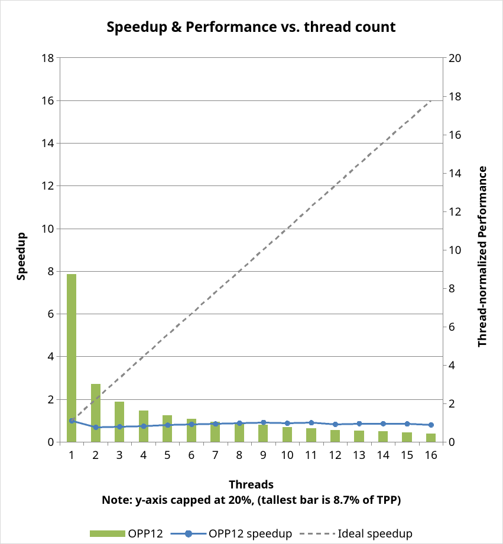

Now we see a near-flat speedup, indicating that the program takes approximately the same amount of time regardless of thread count. Despite speedup being flat, total work relative to TPP declines with thread count, indicating each thread is doing less work.

### OPP13

#### Introduction

If cache-sharing is still having any effect, plain static scheduling (large contiguous chunks per thread, minimizing contention zones) may reduce it further.

#### Design

Based on OPP12; replaced `schedule(static, 64)` with `schedule(static)`.

#### Results

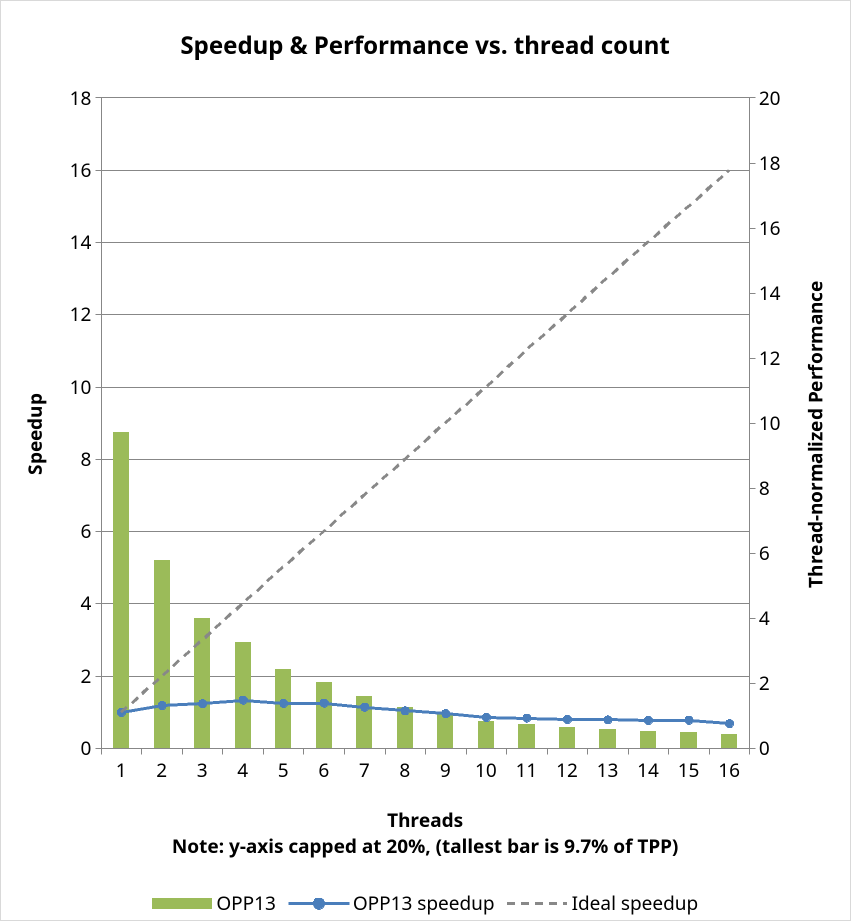

A brief positive curve appears for thread counts under four, which then declines again, even below `schedule(static, 64)`'s performance.

#### Conclusion

The kernel benefits from static scheduling more at low thread counts, where large portions of work can be spread between threads with small contention zones, and less at high counts with more contention zones. Reverting to `schedule(static, 64)` for the time being.

### OPP14

#### Introduction

Instrumented the program to test how many iterations each thread performs, to check whether work is being properly allocated between threads.

#### Hypothesis

The program appears to never exceed single-threaded performance because the work is not being properly allocated between threads.

#### Design

Instrumented each thread to print its iteration count, thread id, and total thread count, using `collapse(2) reduction(+:c[:n]) schedule(static)` and an `omp critical` print.

#### Results

Per-thread iteration counts at 1 through 16 threads all split evenly (e.g. at 16 threads, every thread executes ~250,240-250,256 iterations of ~4,004,001 total - a spread of under 0.01%).

#### Conclusion

Work is being evenly divided between threads, so some other effect must be causing the constant runtime.

### OPP15

#### Introduction

I'm seeing `OMP: Warning #124: Ignoring invalid OS proc ID 20` when running the sweep manually. This appears to be a consequence of `-lomp`, so we remove that from the Makefile.

#### Design

Removed the `-lomp` flag from the Makefile. Kept the OPP11-style split `parallel`/`for` structure, moved to the outer `i` loop with `reduction(+:c[:n])` and `schedule(static)`.

#### Results

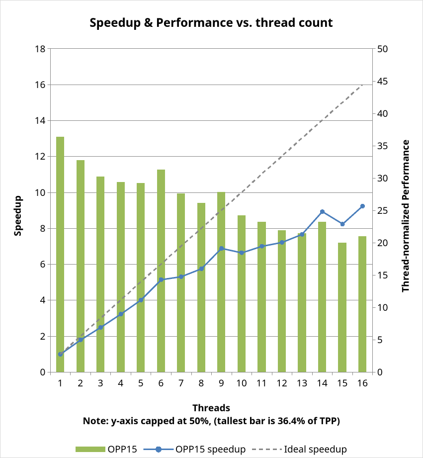

For the first time, we see positive speedup with respect to core count - very slightly sublinear, but clearly positive. The work dimensions on this plot were 2000x2000.

Tuning our work dimensions resulted in a much smoother curve with a better speedup for a 8000x2000 polynomial multiplication:

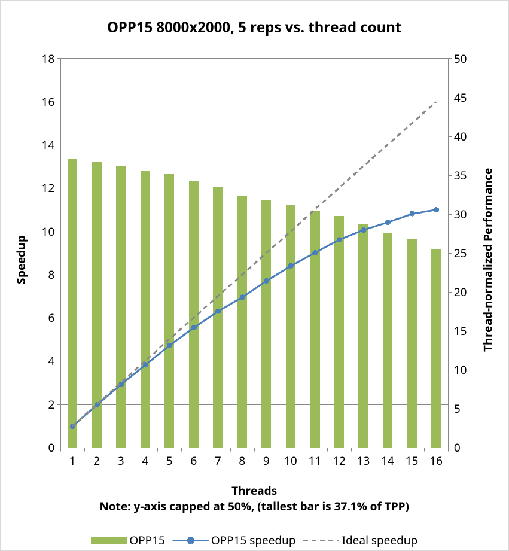

#### Conclusion

My original conclusion was that linking `-lomp` had been barring cores 17-31 from being used at all (treated as invalid targets), leaving one core to serve every thread. The deviation between ideal and actual speedup may represent overhead that grows with core count - either scheduling overhead (unlikely) or interference between threads.

This conclusion was backed up by some casual experimentation with outer loop parallelization, but those findings could not be replicated after this point.

From subsequent findings (EXP12), it seems that inner-parallelization is also responsible for a similar/same effect, though the perfectly flat line found here is a characteristic not matched in this later experiment.

This experiment yielded our most-linear plot yet, with an $R^2$ value of 97.8%. However, it clearly trails off as thread count increases.

### OPP16

#### Introduction

Suspecting sublinear speedup scaling, we copied OPP15 into OPP16, changing scheduling from static to round-robin with a chunk size of `64/sizeof(int)` (a cache-line-aligned chunk).

#### Hypothesis

Using this cache-aligned chunk size should reduce per-thread imbalance and any remaining false sharing, resulting in linear speedup.

#### Design

Used `schedule(static, 64/sizeof(int))`.

#### Results

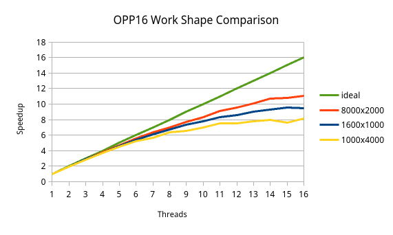

| Threads | 1000x4000 | 8000x2000 | 16000x1000 |
|---|---|---|---|
| 1 | 12.73 (1.00) | 13.01 (1.00) | 12.59 (1.00) |
| 2 | 24.79 (1.95) | 25.80 (1.98) | 24.59 (1.95) |
| 4 | 47.08 (3.70) | 50.00 (3.84) | 47.22 (3.75) |
| 8 | 80.79 (6.35) | 91.09 (7.00) | 84.86 (6.74) |
| 12 | 95.61 (7.51) | 124.80 (9.59) | 108.58 (8.62) |
| 16 | 103.71 (8.15) | 144.05 (11.07) | 119.59 (9.50) |
| % TPP at 16 | 18.4% | 25.6% | 21.2% |

Comparison at 16 threads, GFLOPs/s, against OPP15 (static, no explicit chunk):

| Size | OPP15 (static) | OPP16, chunk 0 | OPP16, chunk 16 |
|---|---|---|---|
| 8000x2000 | 143.53 | 145.41 | 144.05 |
| 1000x4000 | 98.22 | 105.05 | 103.71 |

Chunk 16 gives results close to the zero-chunk runs and to OPP15, all within a few percent, consistent with (but not confirming) the earlier false-sharing hypothesis. Speedup is still sublinear at all three sizes (8.2x, 11.1x, and 9.5x at 16 threads). The new 16000x1000 size scales between the other two.

#### Conclusion

Performance is comparable to OPP15, but slightly lower across all shapes. The shape of the work is a significant contributor to both the speedup of the parallel program and to the achieved proportion of TPP.

### OPP16.2

#### Introduction

For this session, we focuesd on getting perf data from OPP16.

#### Results

Level 1, % of pipeline slots:

| | Retiring | Bad speculation | Backend bound | Frontend bound |
|---|---|---|---|---|
| t=1 | 66.3 | 4.4 | 21.3 | 7.9 |
| t=16 | 43.3 | 2.8 | 37.4 | 16.5 |

Level 2:

| | Core bound | Resource bound | Branch mispredicts | Ifetch latency | Ifetch bandwidth | Machine clears |
|---|---|---|---|---|---|---|
| t=1 | 0.1 | 21.8 | 4.5 | 0.5 | 7.4 | 0.0 |
| t=16 | 0.9 | 37.0 | 2.3 | 0.5 | 16.0 | 0.1 |

The t=1 numbers match the separately-recorded OPP2/OPP21 1-thread run (retiring ~66%, resource bound ~22%, core bound ~0.1%), even though that's a different variant. Going from 1 to 16 threads, retiring falls ~23 points, resource bound rises ~15 points, and ifetch bandwidth roughly doubles; core bound stays under 1%, and bad speculation/machine clears don't move much.

#### Conclusion

Both backend-bound and resource-bound proportions rising substantially at higher thread counts indicates that contention for writing to addresses on the same cache line is causing the overhead.

### OPP2 (Single-Core TPP Baseline)

#### Introduction

Attempting to establish the achievable proportion of TPP on a single core, as a baseline. Inspecting the build found that the outer loop couldn't be vectorized, that the inner `j` loop was vectorized using 32-byte vectors, and that `BPM_ACC` was not vectorized due to a possible dependence between data-refs `*_8` and `*_8`.

#### Design

Built plain OPQ, timed single-threaded, at dA=1000/dB=4000 and dA=8000/dB=2000, 5 reps each.

#### Results

| Run | Work (FLOPs) | Median | GFLOPs/s | % TPP |
|---|---|---|---|---|
| 1000x4000 | 8.0M | 0.629 ms | 12.73 | 36.2% |
| 8000x2000 | 32.0M | 2.455 ms | 13.04 | 37.0% |

The hot loop (offsets 0x98-0xaf):

```asm
98: vmovups     ymm0, [rbx+rdx]
9d: vfmadd213ps ymm0, ymm2, [rax+rdx]  ; ymm0 = b*a[i] + c[i+j..], c loaded from memory as part of the FMA
a3: vmovups     [rax+rdx], ymm0        ; store 8 floats to c[i+j..]
a8: add rdx,0x20 / cmp / jne
```

- **Vectorization:** the inner `j` loop is vectorized 8-wide with 256-bit `ymm` registers and a real `vfmadd213ps` - not a scalar loop wearing a vector label, the failure mode `VectorizationPitfalls.md` warns about.
- **Broadcast:** `a[i]` is broadcast once per outer iteration (`vbroadcastss ymm2`), then reused across the whole `j` loop.
- **Per iteration:** one 8-lane FMA, two loads (`b` and `c`), one store (`c`). The loop isn't unrolled.
- **Alignment:** accesses are `vmovups`, the unaligned form; `c`'s base shifts by one float every `i`. Whether this causes cache-line-split accesses wasn't measured at this point.

#### Conclusion

Both sizes achieved approximately 37% of TPP, far better than the 2.1% of TPP recorded for default GSQ.

### OPP21

#### Introduction

Checking whether aligned accesses improve `vmovups` efficiency.

#### Hypothesis

Aligned access will 

#### Design

Compiled with `BPM_ALIGN=64`.

#### Results

| Size | OPP2 | OPP21 |
|---|---|---|
| 1000x4000 | 0.629 ms, 12.73 GFLOPs/s (36.2%) | 0.634 ms, 12.64 GFLOPs/s (35.9%) |
| 8000x2000 | 2.455 ms, 13.04 GFLOPs/s (37.0%) | 2.454 ms, 13.05 GFLOPs/s (37.1%) |

#### Conclusion

Results are virtually indistinguishable from OPP2 without explicit alignment. The hot loop still has one FMA, two loads, and one store per 8 lanes. It's possible that this additional store is oversaturating the FMA, which is only known to allow for two loads and one FMA to be performed concurrently.

### OPP21.1

#### Introduction

Using `perf` on OPP21 to check for cache misses.

#### Hypothesis

The `j`-index accesses should be very regular and predictable, so the cache miss rate should be well under 1%. If wrong, the access pattern might be reconstructible to lower it.

#### Design

Tested at 8000x2000, 5 reps, using `L1-dcache-load-misses` and `--topdown`.

#### Results

**Run 1 (`L1-dcache-load-misses`):** the event returned `<not supported>` on `cpu_atom`. `L1-dcache-loads` did count: 40,409,296 loads over the whole process (5 reps included) - about twice the ~20 million vector loads expected from the hot loop (~2M loop trips per rep x 2 loads, x 5 reps). Whether this event counts stores, counts loads differently, or includes harness setup wasn't resolved.

**Run 2 (`--topdown`):**

| Category | % of slots |
|---|---|
| Retiring | 66.6 |
| Backend bound | 21.4 |
| Frontend bound | 7.9 |
| Bad speculation | 4.1 |

This is a whole-process measurement, so `malloc`, `fill_random`, and harness output are included.

**Deriving cache misses from `mem_load_uops_retired`:**

| Event | Count |
|---|---|
| `mem_load_uops_retired.l1_hit` | 40,388,614 |
| `mem_load_uops_retired.l1_miss` | 22,017 |

Miss rate = 22,017 / 40,410,631 = 0.054%, well under the 1% expected. Hits plus misses (40,410,631) agree with the `L1-dcache-loads` count above. These are still whole-process counts, so the kernel's own miss count can't be isolated from harness overhead; the ~2x discrepancy against the ~20M-load estimate remains unexplained.

**Backend breakdown (level 2, % of pipeline slots):**

| Metric | % |
|---|---|
| tma_core_bound | 0.1 |
| tma_resource_bound | 22.0 |
| tma_branch_mispredicts | 4.1 |
| tma_ifetch_bandwidth | 7.7 |
| tma_ifetch_latency | 0.2 |
| tma_machine_clears | 0.0 |

Core bound (0.1%) and resource bound (22.0%) sum to ~22.1%, consistent with the level-1 backend-bound figure of 21.4% (the two runs are separate measurements, so the 0.7-point gap isn't meaningful on its own).

Per `Procinfo3.md` §1.D: core bound near zero means execution ports weren't the constraint. Resource bound at 22.0% points to some other limited resource being full, usually in the memory pipeline. §2.B/§2.C describe a high volume of loads/stores cycling through fixed-size load/store queues constraining throughput even with a near-zero L1 miss rate - consistent with, but not proof of, what's happening here.

#### Conclusion

The access is regular enough that cache misses are virtually a non-factor. Other effects must be causing the limited performance.

### OPP2\* (PAPI Attempt)

#### Introduction

Attempting to use PAPI to get more focused hardware information from just the kernel.

#### Conclusion

PAPI cannot read hardware counters because the `perf_event` component is disabled. This line of inquiry cannot be carried out.

### OPP22 (Store-Removal Experiment)

#### Introduction

The hot loop uses 2 loads, 1 FMA, and 1 store per iteration. Removing the store should show whether throughput is limited by the writes.

#### Hypothesis

Two loads can execute concurrently for a single FMA, but nothing is known about stores. Replacing the store with a NOP should bring performance to ~100% of TPP, since a full iteration's work could then be scheduled within a single cycle.

#### Design

`01-OPP22` was created from `01-OPP2`; its compiled assembly was extracted, and

```asm
vmovups YMMWORD PTR [rax+rdx], ymm0
```

replaced with a same-length (5-byte) NOP:

```asm
.byte 0x0f, 0x1f, 0x44, 0x00, 0x00
```

Two directories were built from this assembly - `01-OPP22A` (original store) and `01-OPP22B` (store replaced by NOP) - linked against the harness, and timed with `--allow-gate-failure` (a NOP'd store necessarily fails correctness) at 1000x4000 and 8000x2000, 1 thread, 5 reps.

#### Results

Timing (median of 5, single thread, GFLOPs/s):

| Size | OPP2 (C source) | OPP22A (original asm) | OPP22B (store -> NOP) |
|---|---|---|---|
| 1000x4000 | 12.73 | 12.69 (0.631 ms) | 14.23 (0.563 ms) |
| 8000x2000 | 13.04 | 12.98 (2.466 ms) | 14.25 (2.246 ms) |

Removing the store gives about 12% more throughput at 1000x4000 and about 10% at 8000x2000. The 5 repetitions in each run are tight (within 1-2% of the median). OPP22A matches OPP2's numbers, confirming the assembly copy behaves like the original compiled kernel.

**Perf analysis** (8000x2000, 5 reps, 1 thread, core 16 - same setup as OPP21.1):

Level 1, % of pipeline slots (whole-process counts):

| | Retiring | Bad speculation | Backend bound | Frontend bound |
|---|---|---|---|---|
| OPP22A (original store) | 72.3 / 71.2 (two runs) | -3.2 / -2.9 | 22.2 / 23.1 | 8.6 / 8.6 |
| OPP22B (store -> NOP) | 61.0 | 6.1 | 25.8 | 7.0 |

Level 2:

| | Core bound | Resource bound | Branch mispredicts | Ifetch latency | Ifetch bandwidth | Machine clears |
|---|---|---|---|---|---|---|
| OPP22A | 0.0 | 20.3 | 3.7 | 0.1 | 7.7 | 0.0 |
| OPP22B | 0.0 | 23.6 | 4.0 | 0.1 | 6.0 | 0.1 |

OPP22A dominates its own runtime with retiring ~71-72% and backend bound ~22-23% (resource bound 20.3, core bound 0.0) - the same picture as OPP21.1. In OPP22B, retiring drops ~10 points to 61%, backend bound and resource bound each rise ~3 points, bad speculation flips from -3 to +6, and ifetch bandwidth falls ~1.7 points. Resource bound does not fall when the store is removed, which fits a load-side limit rather than a store-side one.

#### Conclusion

The -3.2/-2.9 "bad speculation" values in OPP22A are not physically meaningful as a share of slots (both OPP22A runs show it; OPP22B doesn't) - possibly hybrid-CPU counter multiplexing showing through, since the level-2 event groups were only sampled for 13-29% of the run. Also, OPP22B retires *fewer* slots than OPP22A while running 10-12% faster in the timed sweeps - retiring is a share of slots, not a measure of useful work, and the NOP itself is a retired instruction doing nothing.

The store is not being scheduled within the same cycle as an FMA operation, resulting in an additional 10-12% overhead per cycle. Because this is a sequential implementation, this is not a side effect of cache interference between threads - the store itself is adding that time.

This configuration, while not doing any useful work, brings throughput up to ~40.5% of TPP, a 3-4% gain over OPP2/OPP21's ~37%. This still leaves a little under 60% of TPP on the table, which must be coming from another source.

Further perf analysis will be performed with and after EXQ/P2.

### OPP18

#### Introduction

The shape of the work set impacts the performance of the program. This session is intended to get an understanding of these effects.

#### Design

Built from OPP17, replacing `schedule(dynamic, 64/sizeof(int))` with `schedule(static)` - otherwise identical outer-loop-with-reduction structure.

#### Results

1000x5000 polynomial:

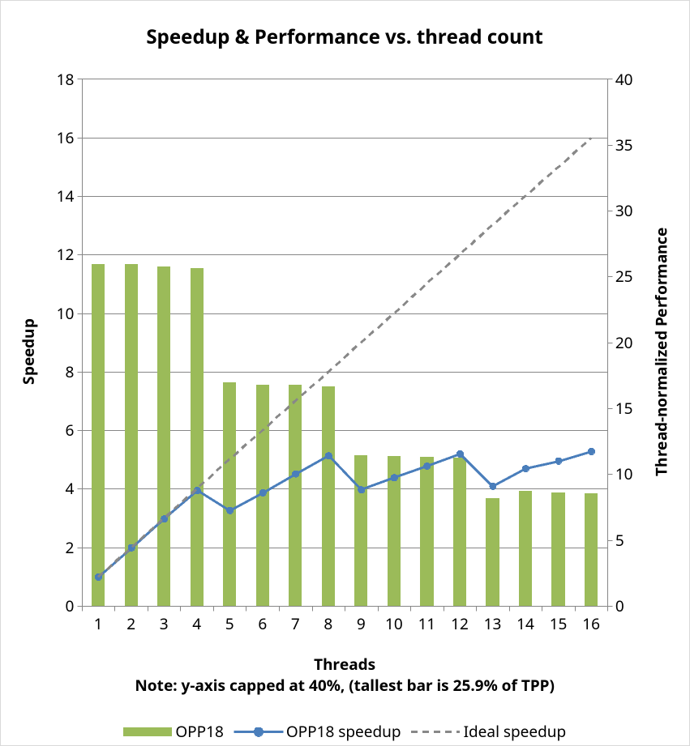

16000x16000

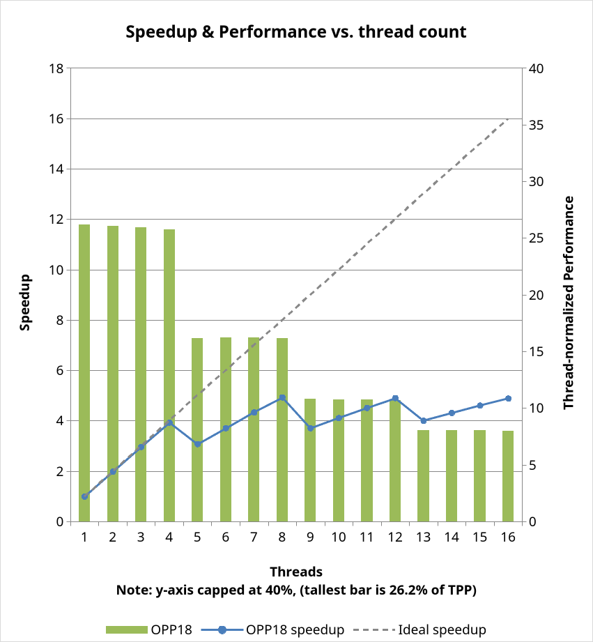

We see clear stepping in both examples as thread counts increase, with relative speedup peaks at 4, 8, 12, and 16 threads

| Threads | Speedup | GFLOPs/s |
|---|---|---|
| 1 | 1.00x | 9.2 |
| 2 | 1.99x | 18.4 |
| 4 | 3.93x | 36.3 |
| 8 | 4.94x | 45.6 |
| 16 | 4.89x | 45.1 |

Throughput is essentially flat from 8 to 16 threads, with a sawtooth dropping at 5, 9, and 13 threads. The single-thread rate here (9.2 GFLOPs/s) is noticeably below the ~12.5-13 GFLOPs/s recorded for OPP16/OPP17 at other sizes.

### OPP110

#### Introduction

Removing the reduction on the outer loop may improve performance.

#### Design

Copy of OPP15 with the `reduction(+:c[:n])` clause removed from the outer-loop `omp for`, leaving `schedule(static)` alone. Sweep planned: 5 reps, 8000x2000 and 1000x4000.

Initially, the correctness gate failed on the parallel binary before any timed sweep could run: 17 of 42 oracle cases failed (worst err/bound up to ~2.8 million), 6 of 14 gold-comparison cases failed. The sequential binary passed cleanly (0/42, 0/14).

The accumulation must be wrapped in a critical section to work properly, as the writes from distinct threads will otherwise interfere with each other. The sequential version passes because it is not subject to race conditions.

#### Hypothesis

Introducing a critical section will greatly decrease the amount of work that can be done in parallel. I expect that speedup will drop to constant, if not negative, as the program effectively becomes more sequential.

#### Results

The program never finished a sweep while I observed it, taking over 100 minutes of CPU time on 14.4 cores. However, it did complete the correctness gate, showing that the critical section does resolve our correctness issue.

#### Conclusion

Without the reduction, different `i` values assigned to different threads write the same `c[i+j]` element with no synchronization, which is a genuine data race - distinct from OPP1/OPP11-13's inner-loop parallelization, where a fixed `i` guarantees distinct `j` write to distinct `c` elements.

With a critical section, the entire program becomes so slow that it is simply automatically inferior to any other implementation. Critical sections may be an alternative to reductions, but they are not a desirable alternative.

## 02 EXQ

Claude wrote an implementation of EXQ (VARIANTS.md's `i`/`j` loop exchange) and it passed the correctness gate.

### EXP1

#### Hypothesis

This algorithm is externally quite OPP, so we expect similar behavior to the OPP family.

#### Design

Outer `parallel for` with `reduction(+:c[:n])` and `schedule(static)` - the same pragma shape as OPP15, applied to EXQ's exchanged loop nest (`j` outer, `i` inner).

#### Results

For the 8000x2000 work distribution which provided good results across OPP, we see the same stepping function arise for EXP.

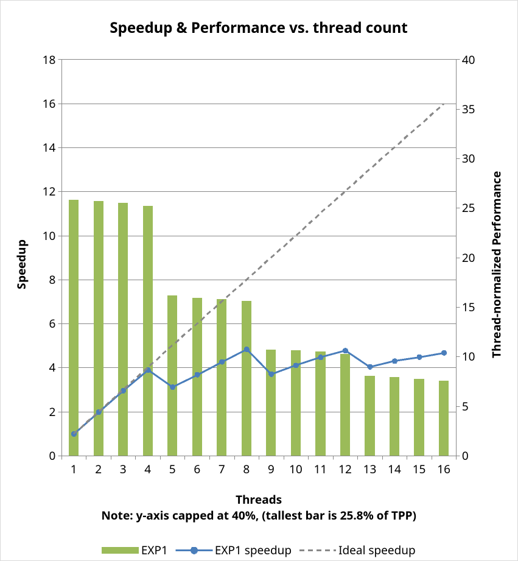

However, the 4000x100 curve


and 1000x4000 curve

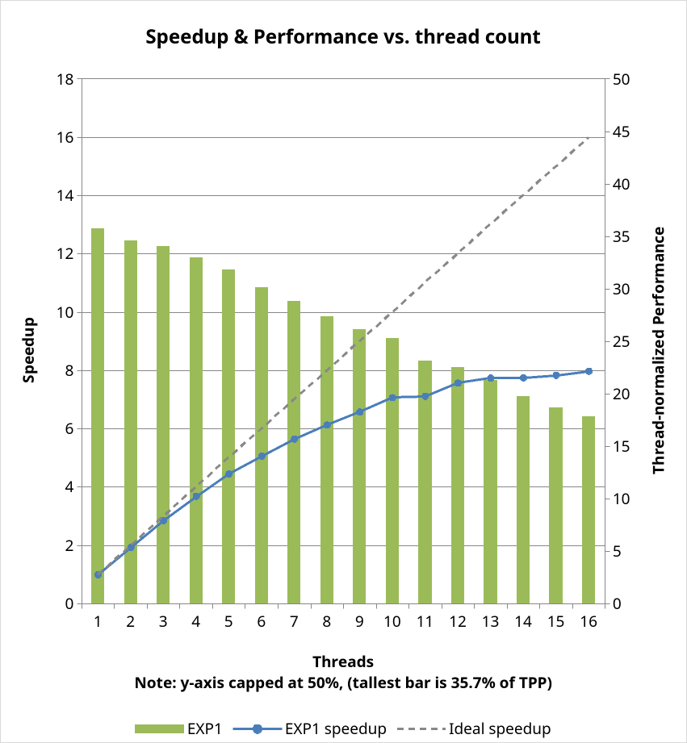

are consistently better, with a similar shape to our OPP15, the best-performing OPP variant.. They do experience a generally worse sublinear speedup than OPP15, peaking around 50% of ideal speedup at 16 cores compared to OPP15's 70%.

#### Conclusion

The speedup curve for the 8000x2000 work distribution indicates that the ideal memory layout for EXP to work on is very different from OPP. This is likely due to changed memory access patterns, and is likely a consequence of caching.

However, the 4000x1000 and 1000x4000 work distributions show that EXP is capable of the same slightly sublinear speedup as OPP15.

### EXP12

#### Introduction

The correctness gate rejects a lot of scheduling algorithms for outer parallelization, so we will return to inner parallelization and see where we can work from there. The synchronization overhead from these inner loops may 

#### Hypothesis

From experience with OPP, I expect that inner parallelization will result in speedup remaining constant at 1.

#### Design

Moved parallelization to inner loop, used static scheduling with chunk size of 16.

#### Results

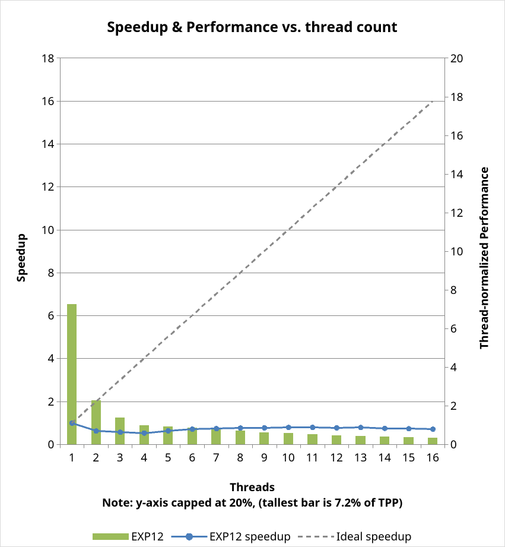

We see a roughly constant speedup at 1 regardless of thread count.

#### Conclusion

Our hypothesis was almost exactly confirmed. The fact that we see a decreasing speedup with increasing core count indicates that it is not the `-lomp` that caused our slowdown for OPP1; it was using inner loop parallelization at all.

### EXP2 and OPP2 Experiments

Using EXQ's own unaltered kernel - already generating the same vectorized instructions as OPP2 - to diagnose what holds it back from TPP, rather than to find a more optimal implementation.

#### Design

Single-threaded (`-t 1`), pinned to core 16, at dA=dB=80000 and dA=dB=160000, across several `perf` event groups: plain `perf stat` with `--topdown`, explicit `cycles`/`instructions`/`cache-references`/`cache-misses`/`branches`/`branch-misses`, `L1-dcache-loads`/`L1-dcache-load-misses`/`LLC-loads`/`LLC-load-misses`, a `perf record -g` call graph, `perf annotate` on the hot loop, explicit `topdown-retiring`/`topdown-be-bound`/`topdown-fe-bound`/`topdown-bad-spec` counters, `-M tma_backend_bound -M tma_memory_bound -M tma_core_bound`, and finally `mem_scheduler_block.all`/`.ld_buf`/`.rsv`/`.st_buf`.

#### Results

**Warmup effect:** at 80000x80000, three reps ran 1.511s, 1.411s, 1.366s (8.47 -> 9.07 -> 9.37 GFLOPs/s), a 9.6% drop from rep 1 to rep 3. At 160000x160000, three reps ran 5.4603s, 5.4588s, 5.4641s - flat, no warmup trend. 384 page faults were recorded at 80000x80000 (first-touch cost), consistent with the warmup effect being a roughly fixed overhead that matters more on the shorter run (~10% of 1.4s) than the longer one (~3% of 5.5s, within noise).

**%TPP at these sizes:** across all recorded reps at both sizes, GFLOPs/s lands in a tight 26.4-26.8% TPP band (e.g. 9.408-9.424 GFLOPs/s / 35.2). This is lower than the ~37% TPP achieved for the smaller 1000x4000/8000x2000 samples in OPP2 and EXQ.

**`perf record -g` profile:** 99.94% of self-time sits in `kernel_multiply`; everything else (`__random`, `memset`, dynamic linker startup) is under 0.1% combined - confirming, at this size, that harness setup isn't polluting any of the counter readings below.

**`perf annotate` on the hot loop:**

| Instruction | % of samples | Role |
|---|---|---|
| `vmovups` (load) | 15.17% | loading 32 B |
| `vfmadd213ps` | 37.95% | main FP computation |
| `vmovups` (store) | 26.67% | storing 32 B |
| `add` | 6.72% | loop index |
| `cmp` | 6.68% | loop termination |
| `jne` | 6.74% | loop branch |

The FMA and store together take 64.6% of attributed cycles; the three loop-bookkeeping instructions take ~20% combined for a non-unrolled, 6-instruction loop doing one 8-wide FMA per trip.

**Cache-counter contradiction:** generic `cache-references`/`cache-misses` reports 77.83% of references as misses at 160000x160000. `LLC-loads`/`LLC-load-misses`, measured separately, shows 0 misses out of 7,548 loads at 160000x160000 (and 3 of 2,185, ~0.14%, at 80000x80000). `L1-dcache-load-misses` reads `<not supported>` on `cpu_atom` in every block, the same limitation OPP21.1 hit. LLC load misses and branch predictor misses are extremely low, but generic "cache" misses are extremely common (78%) - one of these two must be lying, and both ChatGPT and Claude believe that it's the cache-misses event, likely because generic `cache-references`/`cache-misses` don't resolve to a meaningful event on this hybrid chip's E-cores.

**TMA backend attribution:** `-M tma_backend_bound -M tma_memory_bound -M tma_core_bound` gives backend_bound = 46.8%, core_bound = 0.0%. The TMA model is saying that the backend stalls are not being attributed to the core-bound category.

**Memory-scheduler blocking:**

| Event | Count |
|---|---|
| `mem_scheduler_block.all` | 12,446,018,848 |
| `mem_scheduler_block.ld_buf` | 12,020,234,569 |
| `mem_scheduler_block.rsv` | 3,630 |
| `mem_scheduler_block.st_buf` | 425,780,659 |

96.6% of memory-scheduler blocking is load-buffer related, 3.4% is store-buffer related, effectively 0% is RSV-related. The load-buffer blocking event takes 12.02B of 35.6B CPU cycles (~33.8%).

**Follow-up: does OPP2 show the same load-buffer pattern?** The identical `mem_scheduler_block` measurement, run against OPP2 at the same size/conditions (dA=dB=160000, t=1, core 16):

| | OPP2 | EXQ |
|---|---|---|
| `mem_scheduler_block.all` | 12,722,315,777 | 12,446,018,848 |
| `mem_scheduler_block.ld_buf` | 12,048,013,501 | 12,020,234,569 |
| `mem_scheduler_block.rsv` | 3,431 | 3,630 |
| `mem_scheduler_block.st_buf` | 674,298,859 | 425,780,659 |
| ld_buf share of all blocking | 94.7% | 96.6% |
| ld_buf as % of total cycles | 33.3% | 33.8% |

Load-buffer blocking dominates in both variants, at almost the same absolute magnitude. OPP2 shows a somewhat larger store-buffer share (5.3% vs. 3.4%) than EXQ.

#### Conclusion

We can see that the primary performance blocker for EXP2 and OPP2 is Load-buffer blocking. Despite the fact that an FMA is supposed to support two concurrent loads, the CPU is spending approximately a third of its cycles waiting on loads to perform later operations.

We also see that our TPP drops from ~37% to ~26%, matching the observations of many of our classmates. The fact that these effects arise for larger work sets might indicate that performance depends on which cache level the program is going to for data. However, this must be reconciled by the fact that we see almost no accesses straight to main memory.

### Conclusion

This assignment was something of an exercise in frustration. I often felt that I was unable to interpret the data I could gather, and had a great deal of trouble trying to interpret perf data. After starting to use those commands myself, instead of using Claude to recommend relevant avenues of research, I began to see some more interesting and pertinent patterns. I would love to go over the tools we can use to profile our code more in class.

Overall, I was able to place much of the responsibility for our deviation from TPP to load-buffer blocking. This is an interesting finding, as it contradicts our processor information that an FMA can be scheduled concurrently with two loads. The fact that this effect is present at large sizes shows that this effect is dominant even for long strings of vector operations, where that concurrency would dominate.